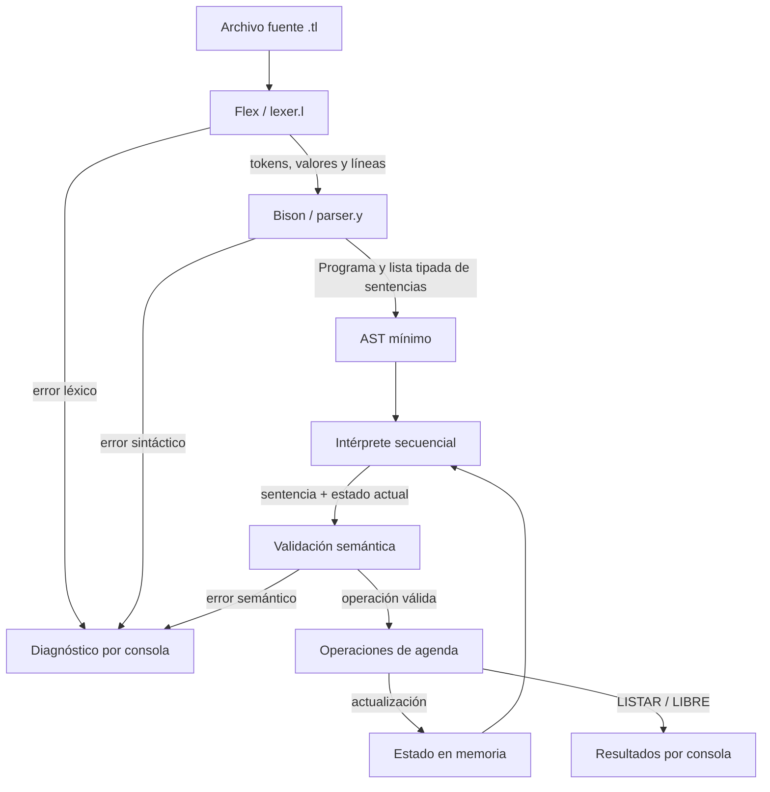

# TurnoLang: propuesta técnica y roadmap

## 1. Introducción al proyecto

### 1.1. Problema y propósito

**TurnoLang** es un lenguaje específico de dominio (DSL, *Domain-Specific
Language*) para describir y ejecutar operaciones sobre la agenda de un único
recurso durante un único día. El recurso puede representar, por ejemplo, un
consultorio, una cancha o una sala. Un programa TurnoLang permite nombrar la
agenda, reservar intervalos, cancelar reservas, consultar disponibilidad y
listar las reservas activas.

Una agenda escrita manualmente puede contener horarios imposibles, intervalos
invertidos, identificadores repetidos o reservas superpuestas. TurnoLang
formaliza esas operaciones mediante una sintaxis pequeña y reglas verificables.
El proyecto no pretende reemplazar un sistema comercial de reservas: su valor
principal es permitir observar de punta a punta las etapas que procesan un
lenguaje.

TurnoLang es apropiado para la materia Compiladores porque presenta, en una
escala controlada:

- análisis léxico de palabras reservadas, identificadores, cadenas, horas y
  signos de puntuación;
- análisis sintáctico mediante una gramática libre de contexto;
- análisis semántico dependiente del estado de la agenda;
- una representación interna mínima del programa; y
- un backend que interpreta las instrucciones y produce resultados observables.

### 1.2. Funcionalidades y límites

El lenguaje ofrecerá cinco operaciones: `AGENDA`, `RESERVAR`, `CANCELAR`,
`LIBRE` y `LISTAR`. Todos los efectos duran solamente mientras se ejecuta el
archivo. No habrá base de datos, persistencia, interfaz gráfica, aplicación web,
API, usuarios, autenticación, múltiples recursos, múltiples días, fechas,
reservas recurrentes ni servicios externos.

Se eligió un **intérprete** porque el resultado natural del dominio es ejecutar
las instrucciones en orden y mostrar el estado o las consultas por consola. No
es necesario generar código máquina ni otro lenguaje destino. Esta elección
sigue cumpliendo la función de backend: una vez aceptado el programa por el
frontend, el intérprete consume su representación interna, mantiene el estado
de la agenda y produce efectos verificables.

## 2. Alcance funcional

Cada archivo fuente tiene extensión `.tl` y describe exactamente una agenda de
un recurso y un día. La cabecera `AGENDA` debe aparecer una vez y antes de las
demás instrucciones.

| Operación | Efecto |
|---|---|
| `AGENDA "nombre";` | Define el nombre no vacío de la única agenda. |
| `RESERVAR id DESDE inicio HASTA fin;` | Agrega una reserva activa si el intervalo y el identificador son válidos y no hay superposición. |
| `CANCELAR id;` | Desactiva la reserva activa indicada. |
| `LIBRE DESDE inicio HASTA fin;` | Informa si todo el intervalo está disponible; no modifica la agenda. |
| `LISTAR;` | Muestra las reservas activas ordenadas por hora de inicio. |

Ejemplo de programa:

```text
AGENDA "Consultorio A";

RESERVAR turno1 DESDE 09:00 HASTA 09:30;
LIBRE DESDE 09:30 HASTA 10:00;
CANCELAR turno1;
LISTAR;
```

La salida será texto por consola. Su redacción exacta se fijará antes de crear
los resultados esperados de las pruebas, para que los casos automatizados no
dependan de mensajes todavía inestables.

## 3. Diseño del lenguaje

### 3.1. Convenciones léxicas

Las palabras reservadas se escriben en mayúsculas y son sensibles a
mayúsculas/minúsculas. Son: `AGENDA`, `RESERVAR`, `DESDE`, `HASTA`, `CANCELAR`,
`LIBRE` y `LISTAR`.

| Token | Lexema de ejemplo | Regla prevista |
|---|---|---|
| `TOK_AGENDA` | `AGENDA` | Palabra reservada literal. |
| `TOK_RESERVAR` | `RESERVAR` | Palabra reservada literal. |
| `TOK_DESDE` | `DESDE` | Palabra reservada literal. |
| `TOK_HASTA` | `HASTA` | Palabra reservada literal. |
| `TOK_CANCELAR` | `CANCELAR` | Palabra reservada literal. |
| `TOK_LIBRE` | `LIBRE` | Palabra reservada literal. |
| `TOK_LISTAR` | `LISTAR` | Palabra reservada literal. |
| `TOK_IDENT` | `turno_1` | `[A-Za-z_][A-Za-z0-9_]*`, excepto palabras reservadas. |
| `TOK_CADENA` | `"Consultorio A"` | Comillas dobles y cero o más caracteres salvo comilla, salto de línea o control. Su contenido se valida luego como no vacío. |
| `TOK_HORA` | `09:30` | Exactamente dos dígitos, `:`, dos dígitos: `[0-9]{2}:[0-9]{2}`. |
| `TOK_PUNTO_Y_COMA` | `;` | Terminador de instrucción. |
| `EOF` | fin del archivo | Fin de entrada informado por Flex/Bison. |

Los espacios, tabulaciones y saltos de línea separan lexemas y no producen
tokens. Para mantener el lenguaje mínimo, la primera versión no incorpora
comentarios ni secuencias de escape dentro de cadenas.

La forma `25:70` sí coincide con `TOK_HORA`: su forma es correcta, aunque su
valor no lo sea. El análisis semántico rechazará horas cuyo componente de hora
no esté entre `00` y `23` o cuyos minutos no estén entre `00` y `59`. En cambio,
`9:30`, `09-30` o `09:3` son horas **mal formadas** y Flex debe reportarlas como
errores léxicos completos, sin dividirlas silenciosamente en otros tokens.

### 3.2. Gramática EBNF

```ebnf
programa       ::= cabecera sentencia* EOF ;
cabecera       ::= AGENDA CADENA ";" ;
sentencia      ::= reserva | cancelacion | disponibilidad | listado ;
reserva        ::= RESERVAR IDENT DESDE HORA HASTA HORA ";" ;
cancelacion    ::= CANCELAR IDENT ";" ;
disponibilidad ::= LIBRE DESDE HORA HASTA HORA ";" ;
listado        ::= LISTAR ";" ;
```

La repetición `sentencia*` permite una agenda sin operaciones después de la
cabecera. No permite un archivo vacío, más de una cabecera ni instrucciones
antes de `AGENDA`. Cada alternativa comienza con una palabra reservada distinta,
por lo que no existe ambigüedad entre tipos de sentencia. `DESDE` y `HASTA`
delimitan las dos horas y evitan que el parser deba inferir su función.

Bison expresará la misma estructura mediante producciones BNF: la repetición se
implementará con una regla recursiva para una lista posiblemente vacía. Las
acciones de las producciones crearán la cabecera y los nodos mínimos de cada
sentencia. Bison no decidirá si `25:70` está fuera de rango ni si una reserva se
superpone: esas condiciones requieren valores o estado y pertenecen al análisis
semántico.

### 3.3. Interpretación de las instrucciones

1. `AGENDA` proporciona el nombre que usará `LISTAR`; no crea múltiples agendas.
2. `RESERVAR` convierte las horas a minutos desde medianoche, valida la operación
   contra el estado actual y, si es válida, incorpora una reserva activa.
3. `CANCELAR` busca una reserva activa con ese identificador y la desactiva. Un
   identificador cancelado puede volver a usarse en una reserva posterior.
4. `LIBRE` valida el intervalo y comprueba si se superpone con alguna reserva
   activa. Solo informa; no reserva el intervalo.
5. `LISTAR` muestra únicamente reservas activas, ordenadas por inicio y, como
   desempate defensivo, por identificador.

## 4. Análisis léxico

El **análisis léxico** es la etapa que transforma una secuencia de caracteres en
una secuencia de tokens. Su entrada es el contenido del archivo `.tl`; su salida
son categorías como `TOK_RESERVAR`, `TOK_IDENT` o `TOK_HORA`, acompañadas por el
valor del lexema cuando corresponde.

Un **lexema** es el texto concreto encontrado (`turno1`); un **token** es la
categoría que se le asigna (`TOK_IDENT`). Una **expresión regular** describe un
conjunto de formas válidas, por ejemplo `[0-9]{2}:[0-9]{2}` describe la forma de
una hora. Flex permite asociar expresiones regulares con acciones C y genera el
scanner que implementa `yylex`.

Para la instrucción:

```text
RESERVAR turno1 DESDE 09:00 HASTA 09:30;
```

Flex producirá:

```text
TOK_RESERVAR TOK_IDENT(turno1) TOK_DESDE TOK_HORA(09:00)
TOK_HASTA TOK_HORA(09:30) TOK_PUNTO_Y_COMA
```

El scanner conservará al menos el número de línea. Una cadena sin cierre, una
hora con separadores o cantidad de dígitos incorrectos y cualquier símbolo no
reconocido producirán un diagnóstico léxico con línea y lexema. El contrato
entre scanner y parser debe evitar que el carácter problemático se ignore.

## 5. Análisis sintáctico

El **análisis sintáctico** comprueba si la secuencia de tokens puede derivarse de
la gramática del lenguaje. Recibe tokens del scanner y valida su orden y
estructura. Una **gramática libre de contexto** define símbolos no terminales,
terminales y producciones; por ejemplo, `listado ::= LISTAR ";"` indica la única
estructura válida de esa instrucción.

Bison es un generador de parsers. A partir de `parser.y` produce código C que
implementa el parser y un encabezado compartido con los tokens. El parser llama
a `yylex`, aplica las producciones y ejecuta sus acciones semánticas. En este
proyecto, esas acciones se limitan a transferir valores y construir el AST; las
reglas de agenda se delegan a funciones C específicas.

Por ejemplo, `LISTAR;` coincide con la producción `listado`. `LISTAR` sin `;`
termina en `EOF` cuando el parser esperaba el terminador y genera un error
sintáctico. El texto se compone de tokens válidos, por lo que no es un error
léxico.

## 6. Análisis semántico

El **análisis semántico** verifica que una construcción sintácticamente válida
tenga sentido dentro del dominio y del estado alcanzado por instrucciones
anteriores. Se implementará con funciones C invocadas por el intérprete antes de
aplicar cada instrucción. Bison construye datos; no contiene algoritmos de
superposición ni administra por sí mismo las reservas.

### 6.1. Modelo temporal

Cada `TOK_HORA` se convierte a minutos desde medianoche. Son válidas las horas
desde `00:00` hasta `23:59`, con ambos componentes dentro de sus rangos. Todo
intervalo debe cumplir `inicio < fin`; por tanto, se rechazan inicio igual a fin
e inicio posterior al fin.

Los intervalos son **semiabiertos**: `[inicio, fin)` incluye el instante de
inicio y excluye el de fin. Gracias a esto, `[09:00, 09:30)` y
`[09:30, 10:00)` son consecutivos pero no se superponen.

Dos intervalos se superponen exactamente cuando:

```text
inicio_nuevo < fin_existente && fin_nuevo > inicio_existente
```

La misma función de intersección se reutilizará para `RESERVAR` y `LIBRE`.

### 6.2. Reglas y casos de borde

| Situación | Decisión |
|---|---|
| Hora con forma correcta pero valores fuera de rango, como `25:00` | Error semántico. |
| Hora mal formada, como `9:00` | Error léxico. |
| Inicio igual al fin | Error semántico: intervalo vacío. |
| Inicio posterior al fin | Error semántico. No se modelan intervalos que crucen de día. |
| Reservas consecutivas | Válidas por usar intervalos semiabiertos. |
| Identificador ya activo | Error semántico. |
| Identificador previamente cancelado | Puede reutilizarse; se crea una nueva reserva activa. |
| Cancelación de identificador inexistente o ya cancelado | Error semántico. |
| Consulta válida sin intersecciones | Informa `DISPONIBLE`. |
| Consulta válida con alguna intersección | Informa `OCUPADO`; no es un error. |
| Nombre de agenda vacío | Error semántico antes de ejecutar sentencias. |

El intérprete procesa los nodos en orden. Para cada nodo, una función
`validar_sentencia` consulta el estado sin modificarlo. Solo si el resultado es
válido, `ejecutar_sentencia` actualiza el estado o produce la salida. Este
contrato separa validación y efecto sin duplicar reglas. Ante el primer error
semántico se detiene el procesamiento; los efectos anteriores solo existieron en
memoria y no se persisten.

Una tabla o lista de reservas activas cumple, en este dominio, el papel de una
tabla de símbolos: asocia identificadores con intervalos y estado. Por el tamaño
esperado y el objetivo académico, una lista dinámica simple es preferible a una
tabla hash.

## 7. Construcción del AST

AST significa **árbol de sintaxis abstracta**. Es una representación que conserva
la información relevante del programa y descarta detalles como palabras de
enlace y puntos y coma. Bison lo construirá mediante acciones asociadas a sus
producciones.

El AST no es obligatorio en el enunciado. Se mantiene porque separa con claridad
el frontend del backend, permite completar el análisis sintáctico antes de
ejecutar y facilita recorrer las instrucciones en el orden fuente. Será mínimo:
un nodo de programa con nombre de agenda y una lista enlazada de nodos de
sentencia. Cada sentencia tendrá un tipo y una unión con solo sus datos.

Representación conceptual de:

```text
RESERVAR turno1 DESDE 09:00 HASTA 09:30;
```

```text
Sentencia
├── tipo: RESERVA
├── identificador: "turno1"
├── inicio: "09:00"
└── fin: "09:30"
```

No se construirá un árbol de cada token ni una jerarquía genérica de objetos. La
implementación deberá incluir creación, recorrido y liberación de memoria, pero
no un framework de nodos. Si durante la implementación esta lista tipada no
aporta separación efectiva, podrá reemplazarse por una lista de sentencias
equivalente; la decisión deberá quedar reflejada de forma consistente en código
y documentación.

## 8. Backend e intérprete

El **frontend** comprende scanner, parser y construcción de la representación
interna. El **backend** consume esa representación y le da un significado
observable. En un compilador tradicional, el backend suele generar código; en
TurnoLang, el backend es un intérprete que ejecuta directamente las operaciones.

Flujo de ejecución:

1. Si hay un error léxico o sintáctico, no se inicia la interpretación.
2. Se valida el nombre de la agenda.
3. Se recorren las sentencias del AST en orden fuente.
4. Antes de cada efecto se llama a la validación semántica correspondiente.
5. `RESERVAR` y `CANCELAR` modifican el estado en memoria.
6. `LIBRE` y `LISTAR` consultan el estado y escriben por salida estándar.
7. Un error semántico informa etapa, línea y motivo y detiene el recorrido.

El lenguaje fuente es el texto `.tl`; la salida textual no es otro programa
TurnoLang ni un lenguaje destino. Es el resultado de interpretar el programa.
Esta distinción se explicará explícitamente en el informe y en la defensa.

## 9. Arquitectura completa



| Componente | Responsabilidad | Recibe | Produce |
|---|---|---|---|
| `lexer.l` | Reconocer lexemas y rechazar caracteres o formas inválidas. | Caracteres del `.tl`. | Tokens, valores y ubicación. |
| `parser.y` | Verificar la gramática y construir sentencias. | Tokens de Flex. | AST mínimo o error sintáctico. |
| AST | Conservar el programa ya reconocido en orden. | Valores de acciones de Bison. | Nodos para el intérprete. |
| Semántica | Validar valores, identificadores e intervalos contra el estado. | Sentencia y estado actual. | Resultado válido/error, sin mutar. |
| Agenda | Administrar reservas activas y algoritmo de intersección. | Operación ya validada. | Estado actualizado o consulta. |
| Intérprete | Coordinar validación y ejecución secuencial. | AST. | Salida o diagnóstico. |
| `main.c` | Abrir archivo, coordinar fases, códigos de salida y limpieza. | Ruta de archivo. | Código de proceso y mensajes. |

## 10. Stack tecnológico

| Herramienta | Descripción | Función | Justificación | Archivo relacionado |
|---|---|---|---|---|
| C | Lenguaje compilado de propósito general. | Implementar estructuras, validación e intérprete. | Es compatible con el código generado y permite mostrar la integración pedida. | `src/*.c`, `src/*.h` |
| Flex | Generador de analizadores léxicos. | Generar `yylex` desde reglas regulares. | Hace explícita y reproducible la etapa léxica. | `src/lexer.l` |
| Bison | Generador de parsers. | Generar el parser desde producciones y acciones. | Hace explícita la gramática y su relación con C. | `src/parser.y` |
| GNU Make | Automatizador por dependencias y objetivos. | Generar, compilar, probar y limpiar. | Un único procedimiento reproducible satisface el requisito de entorno. | `Makefile` |
| GCC | Compilador de C. | Compilar código propio y generado y enlazar el ejecutable. | Herramienta estándar y disponible en entornos GNU. | `Makefile` |
| Shell | Intérprete de comandos. | Ejecutar y comparar escenarios de prueba. | Permite una automatización pequeña, transparente y portable en el entorno elegido. | `scripts/ejecutar_pruebas.sh` |
| Git | Sistema de control de versiones. | Registrar cambios, revisiones y evidencia de avance. | Aporta trazabilidad sin modificar la arquitectura del intérprete. | Repositorio completo |

No se requiere ninguna biblioteca externa de estructuras, testing, base de datos
o interfaz. El README final indicará versiones probadas e instalación para el
entorno concreto; no se declararán compatibles entornos que no hayan sido
verificados.

## 11. Estrategia de pruebas

Cada escenario tendrá un archivo `.tl` y un resultado esperado versionado. El
script ejecutará el intérprete, capturará salida estándar, salida de error y
código de retorno, y los comparará con lo esperado. Una prueba se aprueba solo
si coinciden todos los elementos definidos para ella. `make test` invocará ese
script. Hasta que existan ejecutable, casos y comparación automática, las
pruebas permanecen planificadas y no aprobadas.

| Archivo previsto | Objetivo | Resultado esperado | Etapa/error | Verificación futura |
|---|---|---|---|---|
| `ok_reserva.tl` | Una reserva válida. | Confirmación y/o listado con la reserva. | Sin error. | Salida y código 0. |
| `ok_dos_reservas.tl` | Dos intervalos no superpuestos. | Ambas reservas activas. | Sin error. | Salida y código 0. |
| `ok_listado_ordenado.tl` | Ingresar fuera de orden. | Listado ordenado por inicio. | Sin error. | Comparación exacta. |
| `ok_libre.tl` | Consultar intervalo sin cruces. | `DISPONIBLE`. | Sin error. | Comparación exacta. |
| `ok_ocupado.tl` | Consultar intervalo con cruce. | `OCUPADO`, no un error. | Sin error. | Salida y código 0. |
| `ok_cancelacion.tl` | Cancelar una reserva activa. | Ya no aparece ni ocupa el intervalo. | Sin error. | Comparación exacta. |
| `ok_consecutivas.tl` | Probar límites semiabiertos. | Ambas reservas aceptadas. | Sin error. | Salida y código 0. |
| `ok_reutilizar_id.tl` | Cancelar y volver a reservar el mismo ID. | Nueva reserva activa. | Sin error. | Comparación exacta. |
| `error_id_duplicado.tl` | Repetir un ID activo. | Diagnóstico de duplicado. | Semántico. | `stderr` y código no cero. |
| `error_hora_rango.tl` | Usar `25:00`. | Diagnóstico de hora fuera de rango. | Semántico. | `stderr` y código no cero. |
| `error_intervalo_vacio.tl` | Usar inicio igual a fin. | Diagnóstico de intervalo vacío. | Semántico. | `stderr` y código no cero. |
| `error_intervalo_invertido.tl` | Usar inicio posterior al fin. | Diagnóstico de orden. | Semántico. | `stderr` y código no cero. |
| `error_hora_formato.tl` | Usar `9:00`. | Diagnóstico de lexema de hora. | Léxico. | `stderr` y código no cero. |
| `error_simbolo.tl` | Introducir un símbolo desconocido. | Diagnóstico léxico con línea. | Léxico. | `stderr` y código no cero. |
| `error_sin_punto_y_coma.tl` | Omitir `;`. | Diagnóstico de token esperado. | Sintáctico. | `stderr` y código no cero. |
| `error_superposicion.tl` | Reservar intervalos que se cruzan. | Diagnóstico de superposición. | Semántico. | `stderr` y código no cero. |
| `error_cancelacion_inexistente.tl` | Cancelar ID no activo. | Diagnóstico de identificador. | Semántico. | `stderr` y código no cero. |
| `error_agenda_vacia.tl` | Usar nombre vacío. | Diagnóstico de nombre. | Semántico. | `stderr` y código no cero. |

Los nombres y textos exactos podrán ajustarse durante la implementación, pero
la clasificación y el comportamiento no deben contradecir este diseño.

## 12. Roadmap incremental

La planificación detallada y el estado único de cada tarea se mantienen en
[`scrum/BACKLOG.md`](scrum/BACKLOG.md). Los sprints no tienen fechas ficticias.

| Sprint | Objetivo | Actividades principales | Entregable verificable | Criterio de aceptación | Dependencias |
|---|---|---|---|---|---|
| 0. Definición y preparación | Cerrar el diseño y comprobar el entorno. | Revisar requisitos, especificar lenguaje, semántica y arquitectura; instalar/verificar herramientas. | Documentos coherentes y registro de versiones disponibles. | Requisitos trazados, decisiones cerradas y comandos de versión exitosos. | Ninguna. |
| 1. Compilación | Obtener un ejecutable mínimo reproducible. | Crear estructura, archivos base y Makefile; integrar Flex, Bison y GCC. | `make` genera el ejecutable desde cero. | Compilación limpia y `make clean` elimina solo generados. | Sprint 0. |
| 2. Frontend | Reconocer todo el lenguaje y clasificar errores de forma. | Implementar tokens, lexer, gramática, parser y diagnósticos. | Archivos válidos llegan al AST; casos léxicos/sintácticos fallan correctamente. | Casos de frontend automatizados y sin conflictos Bison injustificados. | Sprint 1. |
| 3. Estructuras y semántica | Representar sentencias y validar reglas de negocio. | AST mínimo, reservas, horas, IDs y superposiciones. | Recorrido semántico con diagnósticos. | Casos de borde definidos pasan/fallan según la especificación. | Sprint 2. |
| 4. Intérprete | Ejecutar las cinco instrucciones en orden. | Mutaciones, consultas, listado y códigos de salida. | Programa completo por consola. | Todos los escenarios funcionales producen salida determinista. | Sprint 3. |
| 5. Pruebas y reproducibilidad | Automatizar evidencia integral. | Completar fixtures, oráculo, runner y documentación de uso. | `make test` entrega resumen y estado. | Una instalación limpia reproduce los resultados documentados. | Sprint 4. |
| 6. Entrega y defensa | Consolidar evidencia académica. | Informe LNCS, README, guion, demo y revisión final. | Paquete final y exposición de hasta 15 minutos. | Trazabilidad completa, referencias reales y demo ensayada. | Sprint 5. |

## 13. Matriz de trazabilidad académica

| Requisito de la cátedra | Componente o evidencia prevista | Prueba o demostración |
|---|---|---|
| Problema, sintaxis y gramática | Secciones 1 a 3; `parser.y`. | Presentar programa válido, inválido y producciones. |
| Palabras reservadas, identificadores y tokens | Sección 3; `lexer.l`. | Traza de tokens y casos léxicos. |
| Análisis léxico con Flex o equivalente | `lexer.l`, archivo generado y Makefile. | `error_hora_formato.tl`, `error_simbolo.tl`. |
| Análisis sintáctico con Bison o equivalente | `parser.y`, encabezado generado y Makefile. | `error_sin_punto_y_coma.tl`. |
| Relación Bison–C | Acciones que crean AST y módulos semánticos C documentados. | Explicar una producción `RESERVAR` y seguir sus datos. |
| Análisis semántico | Módulo de validación y estado de agenda. | Duplicado, rango, intervalo, superposición y cancelación inexistente. |
| Backend verificable | Intérprete secuencial y salida por consola. | Reserva, cancelación, disponibilidad y listado. |
| Errores comprensibles | Diagnósticos con etapa, línea y motivo. | Un caso automatizado de cada clase de error. |
| Generación y compilación automatizadas | `Makefile`. | Ejecución limpia de `make` y `make clean`. |
| Escenarios automatizados | `examples/`, resultados esperados y script. | `make test` y código final. |
| Documentación de entorno | README final con dependencias y comandos verificados. | Reproducción desde una copia limpia. |
| Defensa de hasta 15 minutos | Guion y selección de demo. | Ensayo cronometrado con frontend, semántica y backend. |
| Informe LNCS | Fuente del informe, citas y referencias reales. | Compilación del informe y revisión de figuras/tablas/código. |

## 14. Criterios de diseño y riesgos

Las decisiones futuras deben preservar simplicidad, cohesión, trazabilidad,
reproducibilidad, comprensibilidad, consistencia y alcance controlado. Los
estados «propuesto», «implementado» y «probado» nunca se usarán como sinónimos.

Riesgos técnicos principales:

- confundir errores de forma de hora con valores fuera de rango;
- introducir lógica de negocio dentro de acciones de Bison y duplicarla luego;
- modificar el estado antes de terminar la validación de una sentencia;
- no liberar cadenas o nodos creados por Flex/Bison ante errores;
- depender de textos de salida no estabilizados en las pruebas;
- asumir disponibilidad de Flex, Bison, Make, GCC o una shell sin verificar el
  entorno de ejecución; y
- permitir que roadmap, gramática, código y casos diverjan.

El avance recomendado es implementar primero una reserva válida de punta a
punta y después sumar una regla o instrucción por vez, acompañada por su caso de
prueba. La evidencia real y el siguiente objetivo se mantienen en
[`scrum/SEGUIMIENTO.md`](scrum/SEGUIMIENTO.md).
